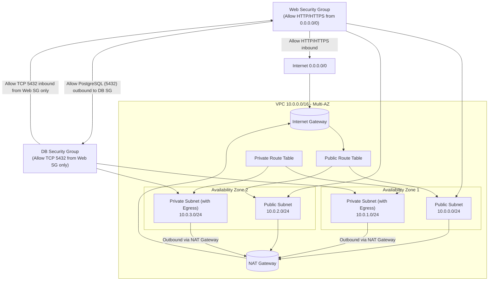

# Arquitectura - Challenge 03: Secure Network

## 1. Contextualización y Objetivo

### Nombre del Proyecto

**challenge-03-secure-network** - [Definido en `cdk/package.json`](cdk/package.json:2)

### Problema que resuelve

La necesidad de aislar la capa web pública de la base de datos privada en AWS, evitando la exposición innecesaria de recursos críticos a Internet. Al mismo tiempo, los recursos ubicados en subredes privadas requieren conectividad hacia Internet para descargar parches de seguridad, actualizaciones de software y dependencias, sin aceptar tráfico entrante no deseado.

### Objetivo General

Definir e implementar mediante AWS CDK una topología de red segura y multi-AZ que garantice:

- Aislamiento de tráfico entre capa pública y capa privada.
- Salida controlada a Internet para recursos privados a través de NAT Gateway.
- Aplicación del principio de mínimo privilegio mediante Security Groups.
- Alta disponibilidad mediante despliegue en múltiples Availability Zones.

## 2. Diagrama de Arquitectura (Mermaid)



## 3. Componentes y Tecnologías

| Componente                 | Detalle                                                                       | Fuente/Versión                                                                                                                                                                                                                                                                                    |
| -------------------------- | ----------------------------------------------------------------------------- | ------------------------------------------------------------------------------------------------------------------------------------------------------------------------------------------------------------------------------------------------------------------------------------------------- |
| **AWS CDK**                | Infraestructura como Código (IaC) para AWS                                    | `aws-cdk@2.1143.0` ([package.json](cdk/package.json:21)), `aws-cdk-lib@^2.270.0` ([package.json](cdk/package.json:26))                                                                                                                                                                            |
| **Lenguaje**               | TypeScript                                                                    | `typescript@~7.0.2` ([package.json](cdk/package.json:23)), `tsx@^4.23.0` ([package.json](cdk/package.json:22))                                                                                                                                                                                    |
| **Constructs**             | Librería para CDK                                                             | `constructs@^10.5.0` ([package.json](cdk/package.json:27))                                                                                                                                                                                                                                        |
| **Runtime Testing**        | Jest para tests unitarios                                                     | `jest@^30` ([package.json](cdk/package.json:20)), `@types/jest@^30` ([package.json](cdk/package.json:18))                                                                                                                                                                                         |
| **VPC**                    | Red virtual privada en AWS                                                    | CIDR `10.0.0.0/16` ([secure-network-stack.ts:16](cdk/lib/secure-network-stack.ts:16)) - 2 AZs, `maxAzs: 2` ([secure-network-stack.ts:17](cdk/lib/secure-network-stack.ts:17))                                                                                                                     |
| **Subnets Públicas**       | Conectadas a Internet Gateway                                                 | Nombre `Public` ([secure-network-stack.ts:22](cdk/lib/secure-network-stack.ts:22)), CIDR mask `/24` ([secure-network-stack.ts:21](cdk/lib/secure-network-stack.ts:21)), `SubnetType.PUBLIC` ([secure-network-stack.ts:23](cdk/lib/secure-network-stack.ts:23)) - 1 por AZ                         |
| **Subnets Privadas**       | Con salida a Internet vía NAT Gateway                                         | Nombre `PrivateWithEgress` ([secure-network-stack.ts:27](cdk/lib/secure-network-stack.ts:27)), CIDR mask `/24` ([secure-network-stack.ts:26](cdk/lib/secure-network-stack.ts:26)), `SubnetType.PRIVATE_WITH_EGRESS` ([secure-network-stack.ts:28](cdk/lib/secure-network-stack.ts:28)) - 1 por AZ |
| **Internet Gateway (IGW)** | Provee conectividad a Internet para subnets públicas                          | Creado automáticamente por CDK VPC construct ([secure-network-stack.ts:15-31](cdk/lib/secure-network-stack.ts:15-31))                                                                                                                                                                             |
| **NAT Gateway**            | Habilita salida a Internet para subnets privadas sin exponer tráfico entrante | `natGateways: 1` ([secure-network-stack.ts:18](cdk/lib/secure-network-stack.ts:18)) - configurado a nivel VPC (un NAT Gateway compartido en AZs)                                                                                                                                                  |
| **Route Tables**           | Enrutamiento entre subnets, IGW y NAT Gateway                                 | Gestionadas automáticamente por CDK VPC construct para cada tipo de subnet                                                                                                                                                                                                                        |
| **VPC Flow Logs**          | Logging de tráfico VPC para auditoría                                         | `LogGroup` con retención 1 semana ([secure-network-stack.ts:33-36](cdk/lib/secure-network-stack.ts:33-36)), destino CloudWatch Logs ([secure-network-stack.ts:38-42](cdk/lib/secure-network-stack.ts:38-42))                                                                                      |
| **Web Security Group**     | SG para instancias en capa pública                                            | `web-sg` ([secure-network-stack.ts:46](cdk/lib/secure-network-stack.ts:46)), permite HTTP(80)/HTTPS(443) desde `0.0.0.0/0` ([secure-network-stack.ts:51-60](cdk/lib/secure-network-stack.ts:51-60))                                                                                               |
| **DB Security Group**      | SG para instancias en capa privada                                            | `db-sg` ([secure-network-stack.ts:64](cdk/lib/secure-network-stack.ts:64)), permite TCP 5432 únicamente desde Web SG ([secure-network-stack.ts:70-74](cdk/lib/secure-network-stack.ts:70-74))                                                                                                     |
| **Instancias de Prueba**   | EC2 para validación de conectividad                                           | Amazon Linux 2023 ([secure-network-stack.ts:83](cdk/lib/secure-network-stack.ts:83)), tipo `t3.micro` ([secure-network-stack.ts:88,97](cdk/lib/secure-network-stack.ts:88,97)), con IAM role para SSM ([secure-network-stack.ts:76-81](cdk/lib/secure-network-stack.ts:76-81))                    |

## 4. Justificación Técnica (El "¿Por qué?" de las decisiones)

| Decisión                                     | Justificación                                                                                                                                                                                                                                                                                                                                                                    |
| -------------------------------------------- | -------------------------------------------------------------------------------------------------------------------------------------------------------------------------------------------------------------------------------------------------------------------------------------------------------------------------------------------------------------------------------- |
| **Uso de AWS CDK (IaC)**                     | Permite definir infraestructura mediante código TypeScript, garantizando reproducibilidad, versionado, validación sintáctica, revisión en control de versiones y eliminación de configuraciones manuales propensas a errores.                                                                                                                                                    |
| **Estrategia Multi-AZ**                      | Despliegue en 2 Availability Zones ([secure-network-stack.ts:17](cdk/lib/secure-network-stack.ts:17)) proporciona alta disponibilidad y tolerancia a fallos ante indisponibilidad de una AZ, manteniendo resiliencia de la arquitectura.                                                                                                                                         |
| **NAT Gateway en subnets privadas**          | Permite a recursos privados (como bases de datos o aplicaciones internas) realizar descargas de parches, actualizaciones y llamadas a APIs externas, sin exponer ningún puerto entrante desde Internet. La configuración `PRIVATE_WITH_EGRESS` junto con `natGateways: 1` ([secure-network-stack.ts:18,28](cdk/lib/secure-network-stack.ts:18,28)) habilita este comportamiento. |
| **Referencia cruzada entre Security Groups** | El DB Security Group referencia explícitamente al Web Security Group ([secure-network-stack.ts:71](cdk/lib/secure-network-stack.ts:71)) para permitir tráfico TCP 5432, en lugar de usar CIDRs. Esto aplica el principio de menor privilegio - solo instancias asociadas al Web SG pueden acceder a la base de datos.                                                            |
| **Separación de capas (Public vs Private)**  | Subnets públicas albergan recursos que necesitan exposición controlada (punto de entrada), mientras subnets privadas albergan datos sensibles. Esto reduce la superficie de ataque.                                                                                                                                                                                              |
| **VPC Flow Logs habilitados**                | Facilita monitoreo, auditoría de seguridad y troubleshooting al capturar todo el tráfico IP en la VPC ([secure-network-stack.ts:38-42](cdk/lib/secure-network-stack.ts:38-42)).                                                                                                                                                                                                  |
| **Acceso SSM habilitado**                    | Las instancias tienen rol IAM con `AmazonSSMManagedInstanceCore` ([secure-network-stack.ts:78-80](cdk/lib/secure-network-stack.ts:78-80)), permitiendo conexión segura sin necesidad de bastión con claves SSH.                                                                                                                                                                  |

## 5. Preguntas Frecuentes (Preguntas y Respuestas)

### 1. ¿Por qué la base de datos no puede ser alcanzada directamente desde Internet?

Porque la base de datos se encuentra en **subnets privadas** (`PrivateWithEgress`) sin rutas hacia el Internet Gateway para tráfico entrante. Además, su **Security Group (DB SG)** solo permite tráfico entrante TCP 5432 desde el **Web Security Group** ([secure-network-stack.ts:70-74](cdk/lib/secure-network-stack.ts:70-74)), rechazando cualquier conexión proveniente de `0.0.0.0/0`. No hay ningún recurso con IP pública asociado a estas instancias.

### 2. ¿Cómo verifica una instancia privada que tiene conectividad hacia afuera sin aceptar tráfico entrante?

Mediante **NAT Gateway**. Las subnets privadas tienen tablas de ruta que redirigen tráfico hacia Internet (destino `0.0.0.0/0`) al NAT Gateway ([diagrama arquitectura](#2-diagrama-de-arquitectura-mermaid)), el cual a su vez enruta hacia el Internet Gateway. El NAT Gateway realiza NAT (Network Address Translation), permitiendo que respuestas regresen a la instancia privada, pero **no permite conexiones iniciadas desde Internet** hacia las instancias privadas. Esto es validado por el script `scripts/test-network.sh` ejecutando `curl https://aws.amazon.com` desde la instancia privada vía AWS Systems Manager ([test-network.sh:20-37](scripts/test-network.sh:20-37)).

### 3. ¿Cómo se evita que el Security Group de la base de datos sea vulnerable a accesos globales?

El DB SG no tiene reglas `allowAllInbound` ni reglas que acepten `0.0.0.0/0`. En su lugar, utiliza **referencia cruzada al Web SG** (`this.webSecurityGroup` como peer) para permitir únicamente conexiones TCP 5432 provenientes de instancias asociadas al Web Security Group ([secure-network-stack.ts:71](cdk/lib/secure-network-stack.ts:71)). Este enfoque sigue el principio de menor privilegio y es más seguro que especificar rangos CIDR.

### 4. ¿Qué ocurre si falla una Availability Zone?

La infraestructura está desplegada en **2 AZs** con subnets públicas y privadas en cada una ([secure-network-stack.ts:17,19-31](cdk/lib/secure-network-stack.ts:17,19-31)). Con `natGateways: 1`, existe 1 NAT Gateway compartido. En caso de fallo de la AZ donde reside el NAT Gateway, las instancias privadas en la otra AZ perderían conectividad egress hacia Internet hasta que se recupere, o hasta que se redirijan rutas. Para mayor resiliencia, lo ideal sería configurar `natGateways: 2` (uno por AZ). Sin embargo, la implementación actual define `natGateways: 1` explícitamente ([secure-network-stack.ts:18](cdk/lib/secure-network-stack.ts:18)), lo cual representa una elección de diseño consciente (menor costo, pero menor resiliencia frente a fallo de AZ del NAT Gateway).

## 6. Comandos Útiles

Todos los comandos deben ejecutarse desde el directorio `cdk/` ([cdk.json](cdk/cdk.json:2), [package.json](cdk/package.json:4-14)).

| Comando             | Descripción                                                                                                               |
| ------------------- | ------------------------------------------------------------------------------------------------------------------------- |
| `npm install`       | Instalación de dependencias del proyecto.                                                                                 |
| `npm run build`     | Compila TypeScript a JavaScript (`tsc`).                                                                                  |
| `npm run synth`     | Sintetiza el template de CloudFormation (`cdk synth`). Verifica que la infraestructura compila correctamente sin errores. |
| `npm run diff`      | Compara el stack desplegado con el código local (`cdk diff`). Muestra cambios pendientes.                                 |
| `npm run deploy`    | Despliega el stack a la cuenta/región AWS configurada (`cdk deploy`).                                                     |
| `npm run destroy`   | Elimina todos los recursos creados por el stack (`cdk destroy`). **Usar con precaución.**                                 |
| `npm run test`      | Ejecuta tests unitarios con Jest.                                                                                         |
| `npm run bootstrap` | Bootstrap de CDK en el ambiente AWS (`cdk bootstrap`) - requerido una sola vez por cuenta/región.                         |

### Comandos CDK directos (alternativos)

```bash
cd cdk
npx cdk synth
npx cdk diff
npx cdk deploy
npx cdk destroy
```

### Validación post-despliegue

Tras desplegar, puede ejecutarse el script de validación para comprobar conectividad:

```bash
bash scripts/test-network.sh
```

Este script valida: (1) salida a Internet desde instancia privada vía NAT Gateway, (2) conectividad desde instancia pública hacia puerto 5432 de instancia privada ([test-network.sh](scripts/test-network.sh)).

## 7. Conclusiones y Criterios de Éxito Cumplidos

### Logros principales

- **Topología segura implementada**: Separación clara entre capa pública (Web) y privada (DB) con rutas y Security Groups correctamente configurados.
- **Principio de mínimo privilegio**: DB SG únicamente acepta tráfico desde Web SG, sin apertura a Internet.
- **Salida controlada**: Recursos privados pueden acceder a Internet a través de NAT Gateway sin exponerse a tráfico entrante.
- **Alta disponibilidad**: Arquitectura multi-AZ (2 AZs) con subnets en ambas zonas.
- **Infraestructura como Código**: Toda la topología definida en CDK TypeScript, versionada y reproducible.
- **Observabilidad**: VPC Flow Logs habilitados para auditoría.
- **Validación integrada**: Script de pruebas automatizadas para verificar conectividad según requisitos.
